# ReVLC

A modern, lightweight media player built on libVLC.

**[revlc.vercel.app](https://revlc.vercel.app)** · [Download the alpha](https://github.com/HiteshRohira/ReVLC/releases/tag/v0.2.0-alpha)

ReVLC aims for full VLC feature parity with a cleaner, faster UI. It is early:
see the [feature parity checklist](docs/parity.md) for what works today and
what's next.

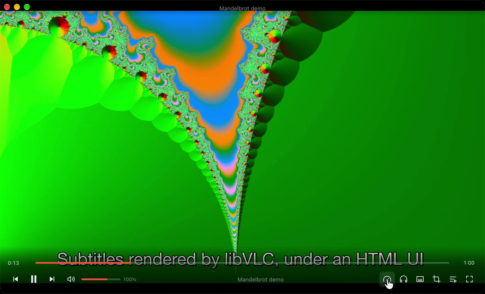

## Screenshots

Click any screenshot for the full size.

<table>
  <tr>
    <td width="50%"><a href="docs/screenshots/home.jpg">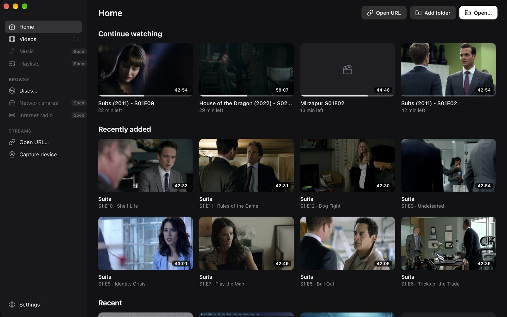</a><br><b>Home</b>: continue watching and recently added</td>
    <td width="50%"><a href="docs/screenshots/library.jpg">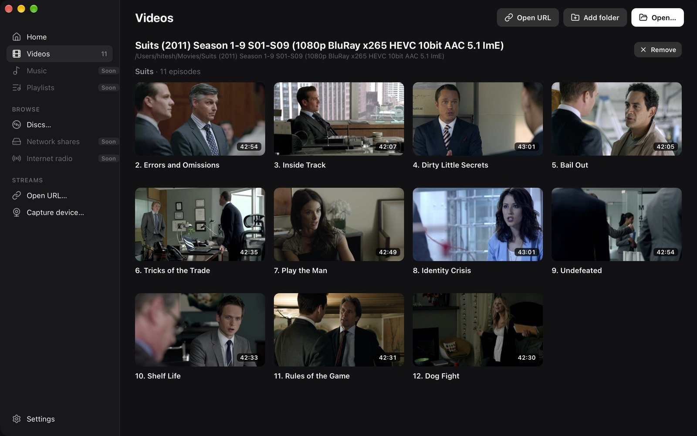</a><br><b>Library</b>: shows grouped by season, with episode titles</td>
  </tr>
  <tr>
    <td><a href="docs/screenshots/menu.jpg">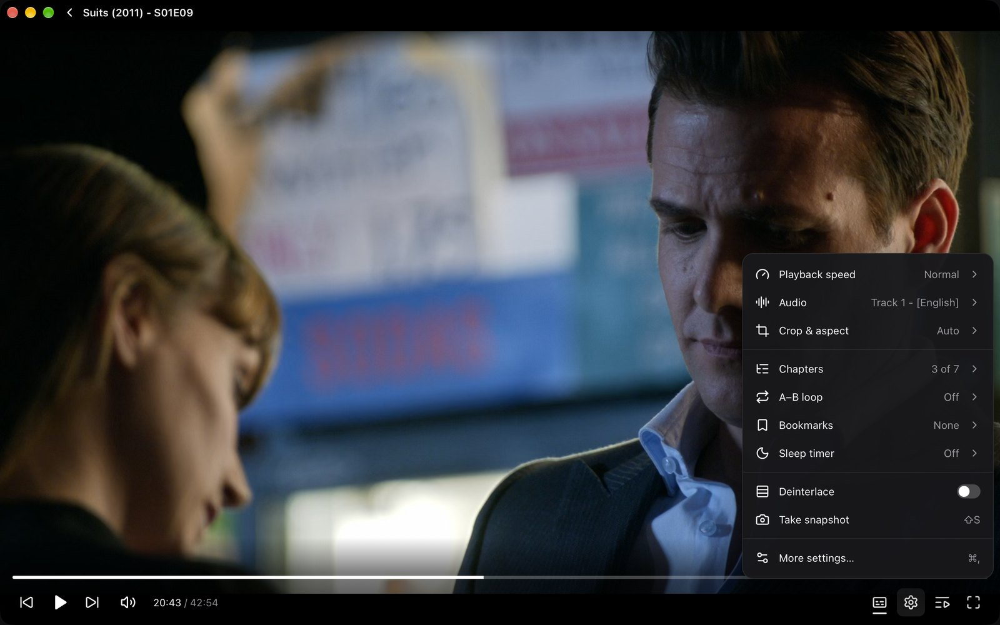</a><br><b>Player menu</b>: speed, audio, crop, chapters, A–B loop, bookmarks, sleep timer</td>
    <td><a href="docs/screenshots/chapters.jpg">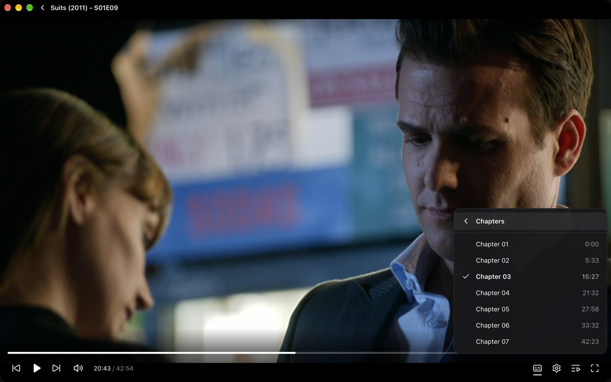</a><br><b>Chapters</b></td>
  </tr>
  <tr>
    <td><a href="docs/screenshots/subtitles-menu.jpg">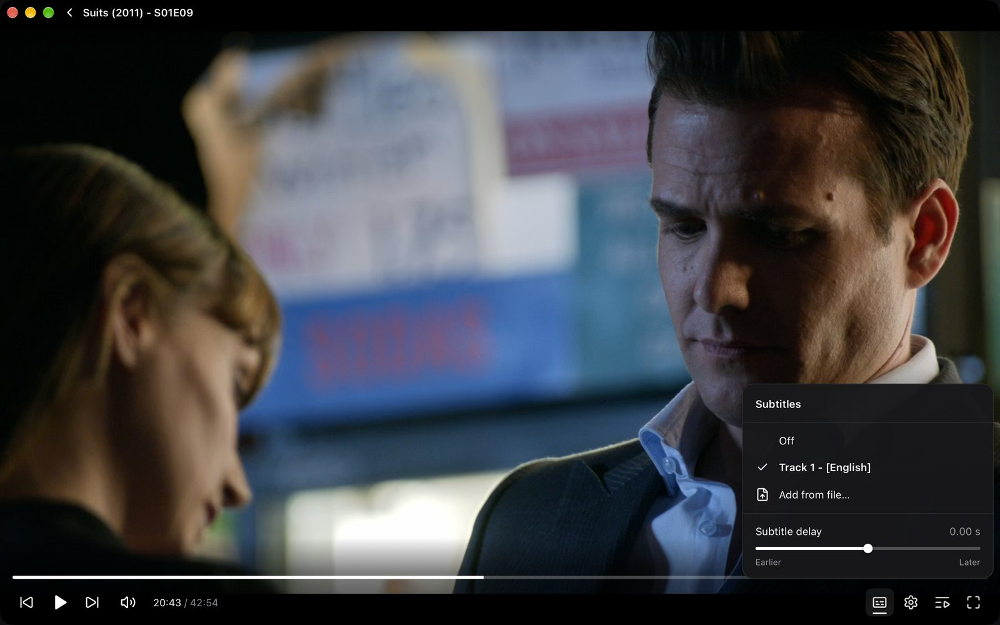</a><br><b>Subtitles</b>: tracks, external files, delay</td>
    <td><a href="docs/screenshots/queue.jpg">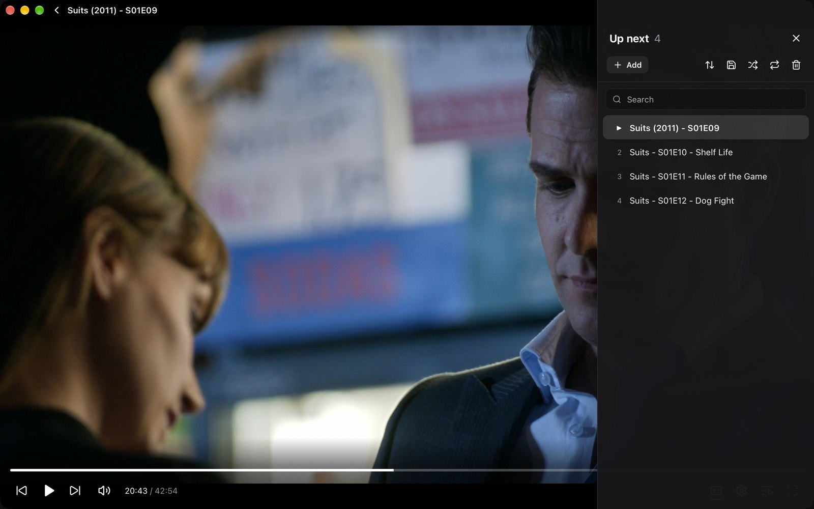</a><br><b>Up next</b>: search, sort, save as M3U, PLS or XSPF</td>
  </tr>
  <tr>
    <td><a href="docs/screenshots/jump.jpg">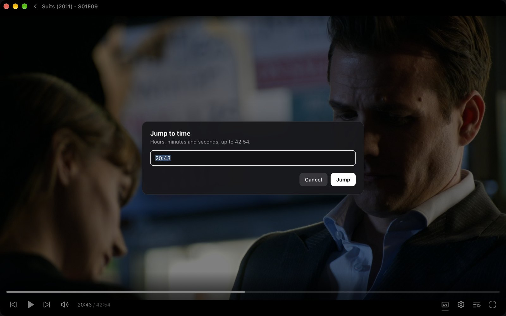</a><br><b>Jump to time</b> (⌘T)</td>
    <td><a href="docs/screenshots/disc.jpg">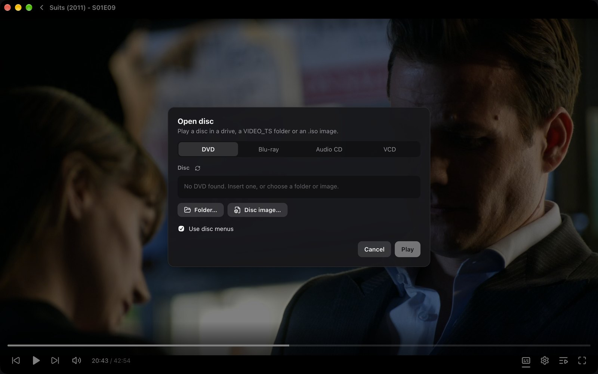</a><br><b>Open disc</b>: DVD, Blu-ray, audio CD, VCD, ISO</td>
  </tr>
  <tr>
    <td><a href="docs/screenshots/settings-general.jpg">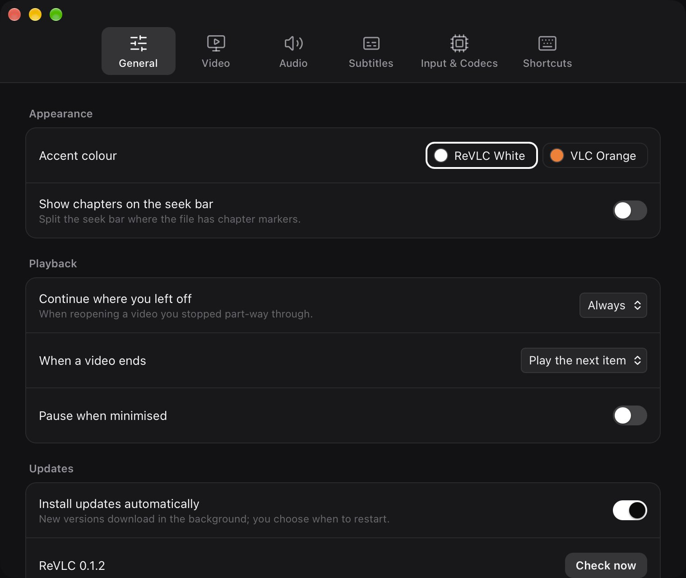</a><br><b>Settings</b>: General</td>
    <td><a href="docs/screenshots/settings-subtitles.jpg">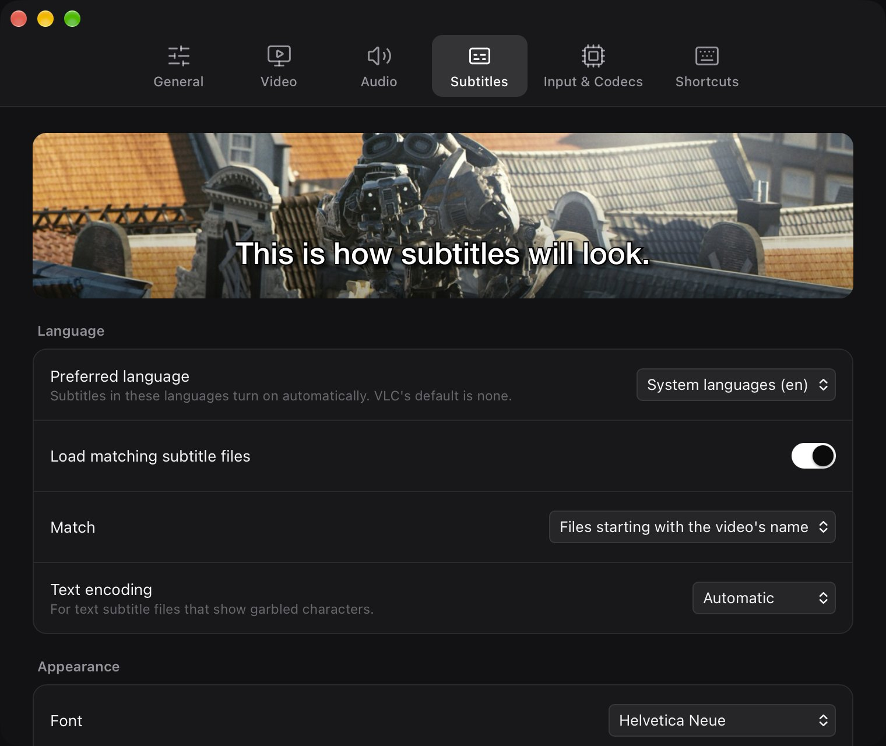</a><br><b>Settings</b>: subtitle styling with a live preview</td>
  </tr>
  <tr>
    <td><a href="docs/screenshots/settings-shortcuts.jpg">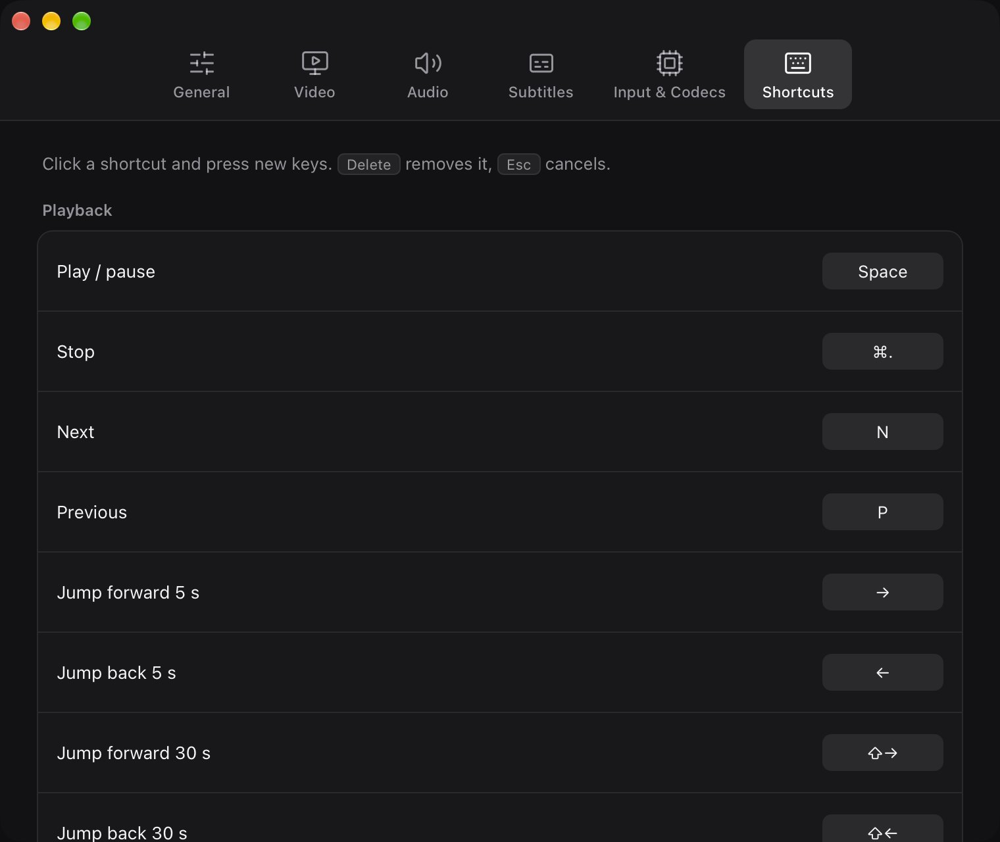</a><br><b>Settings</b>: editable, VLC-style shortcuts</td>
    <td></td>
  </tr>
</table>

## Stack

- **Engine:** libVLC 3 (the same engine as VLC), loaded at runtime
- **Core:** Rust (player state, playlist, events)
- **UI:** Tauri 2 + Svelte 5, rendered by the system web view
- **Video:** libVLC draws into a native view placed under a transparent web
  view, so the HTML controls sit on top of hardware-decoded video

See [docs/plan.md](docs/plan.md) for the reasoning and milestones.

## Install (macOS, Apple Silicon)

Download the `.dmg` from [Releases](../../releases) and drag ReVLC to
Applications. Builds aren't notarised yet, so the first time, right-click
ReVLC and choose **Open**, or run `xattr -cr /Applications/ReVLC.app`.
After that, ReVLC updates itself (Settings → General → Updates).

## Install (Windows 10 and 11, 64-bit)

Download `ReVLC-<version>-alpha-x64-setup.exe` from [Releases](../../releases)
and run it; it installs for the current user, no admin rights needed. The
installer isn't code-signed yet, so if SmartScreen warns about it, choose
**More info** → **Run anyway**.

## Building

Requirements: Rust, Node 20+. On Windows, run the scripts from Git Bash.

```sh
npm install
npm run prepare:vlc   # macOS: copies libVLC from /Applications/VLC.app or downloads VLC 3; Windows: downloads VLC 3
npm run tauri dev     # run in development
npm run build:app     # macOS: ReVLC.app and a .dmg; Windows: an NSIS installer (both in src-tauri/target/release/bundle)
```

`prepare:vlc` puts libVLC (libraries, plugins and Lua scripts, about 80 MB)
in `src-tauri/vlc`, which is bundled into the app. Without it, development
builds fall back to an installed VLC.app. Set `REVLC_VLC_DIR` to use libVLC
from somewhere else (a directory with `lib/`, `plugins/` and `share/`; on
Windows, VLC's own layout with the DLLs next to `plugins/` and `lua/`).

### Releasing

`build:app` signs the updater archive with `~/.tauri/revlc-updater.key`;
installed copies only accept updates signed with that key. Then:

```sh
scripts/release-files.sh "What changed"   # release/ files + site/latest.json
gh release create v<version>-alpha release/* --prerelease
cd site && vercel deploy --prod            # publishes latest.json; apps see the update
```

## Known issues

- Subtitles can overlap the control bar while it's visible (Settings → Subtitles → "Raise subtitles by" moves them up).
- HDR is tone-mapped to SDR by libVLC 3 (true HDR on XDR displays is milestone M2).
- Linux isn't supported yet.
- Windows: the installer isn't code-signed yet, and Windows copies don't update themselves yet.

## Contributing

Pick an unchecked item in [docs/parity.md](docs/parity.md). Most "engine"
items only need UI and a thin command in `src-tauri/src/vlc.rs`.

## License

GPL-3.0-or-later. The app bundles libVLC (LGPL-2.1-or-later) and VLC
plugins (GPL/LGPL) from [VideoLAN](https://www.videolan.org/); their
source code is available at https://code.videolan.org/videolan/vlc.
