# ReVLC

A modern, lightweight media player built on libVLC.

**[revlc.vercel.app](https://revlc.vercel.app)** · [Download the alpha](https://github.com/HiteshRohira/ReVLC/releases/tag/v0.2.8-alpha)

ReVLC aims for full VLC feature parity with a cleaner, faster UI. It is early:
see the [feature parity checklist](docs/parity.md) for what works today and
what's next.

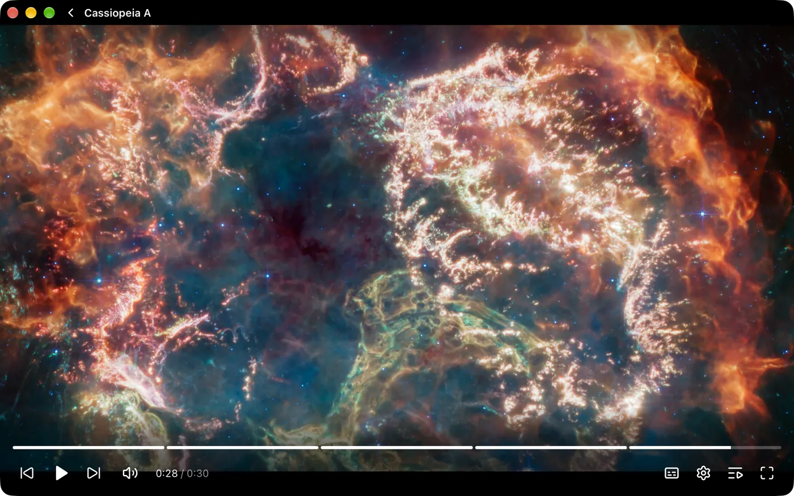

<sub>Cassiopeia A · ESA/Webb. Footage credits are under [Credits](#credits).</sub>

<details>
<summary><b>More screenshots</b></summary>
<br>

Click any screenshot for the full size, or browse [docs/screenshots](docs/screenshots).

<table>
  <tr>
    <td width="50%"><a href="docs/screenshots/home.webp">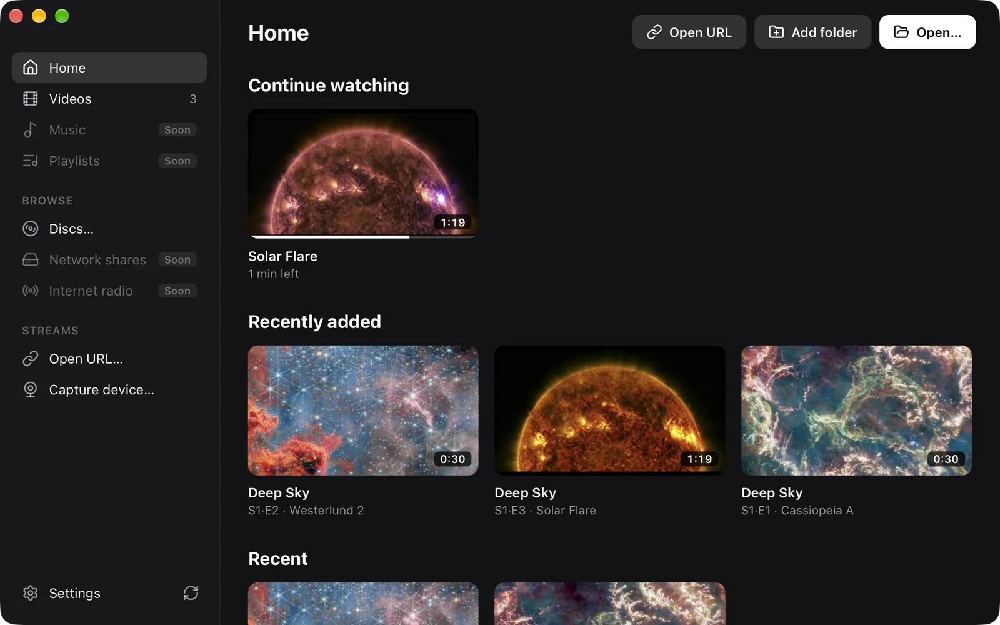</a><br><b>Home</b>: continue watching and recently added</td>
    <td width="50%"><a href="docs/screenshots/library.webp">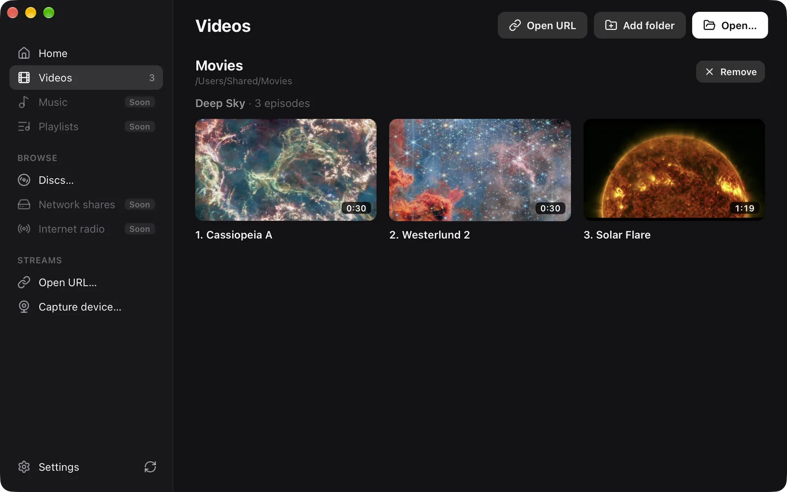</a><br><b>Library</b>: shows grouped by season, with episode titles</td>
  </tr>
  <tr>
    <td><a href="docs/screenshots/menu.webp">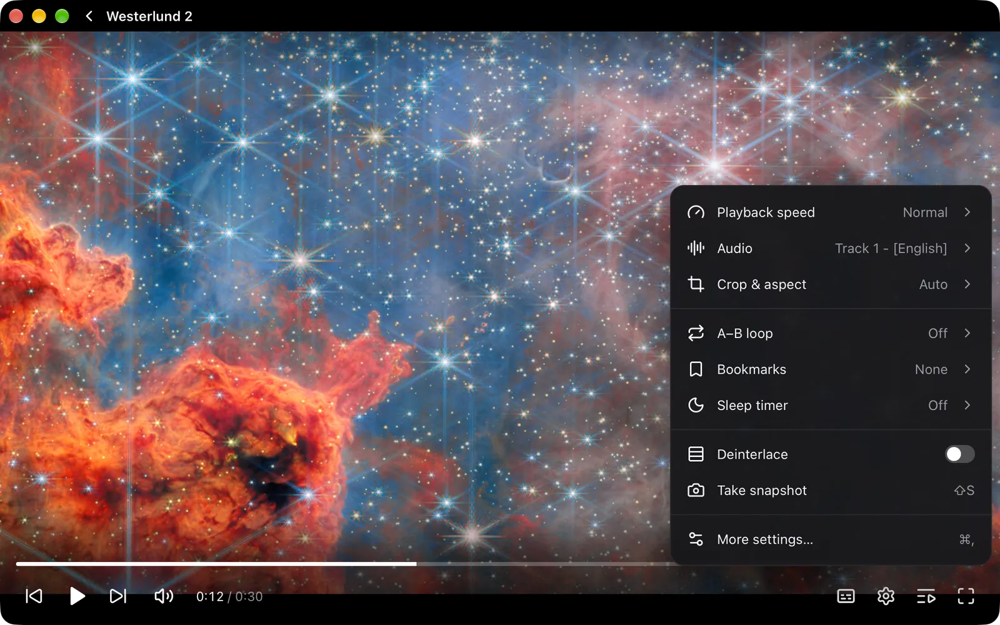</a><br><b>Player menu</b>: speed, audio, crop, chapters, A–B loop, bookmarks, sleep timer</td>
    <td><a href="docs/screenshots/chapters.webp">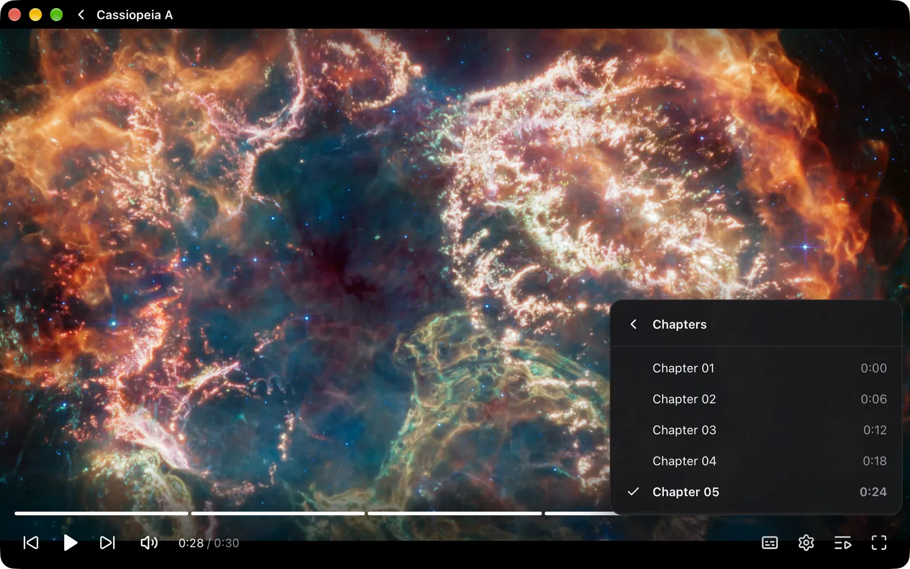</a><br><b>Chapters</b></td>
  </tr>
  <tr>
    <td><a href="docs/screenshots/subtitles-menu.webp">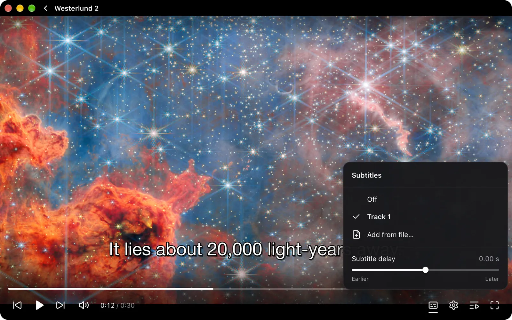</a><br><b>Subtitles</b>: tracks, external files, delay</td>
    <td><a href="docs/screenshots/queue.webp">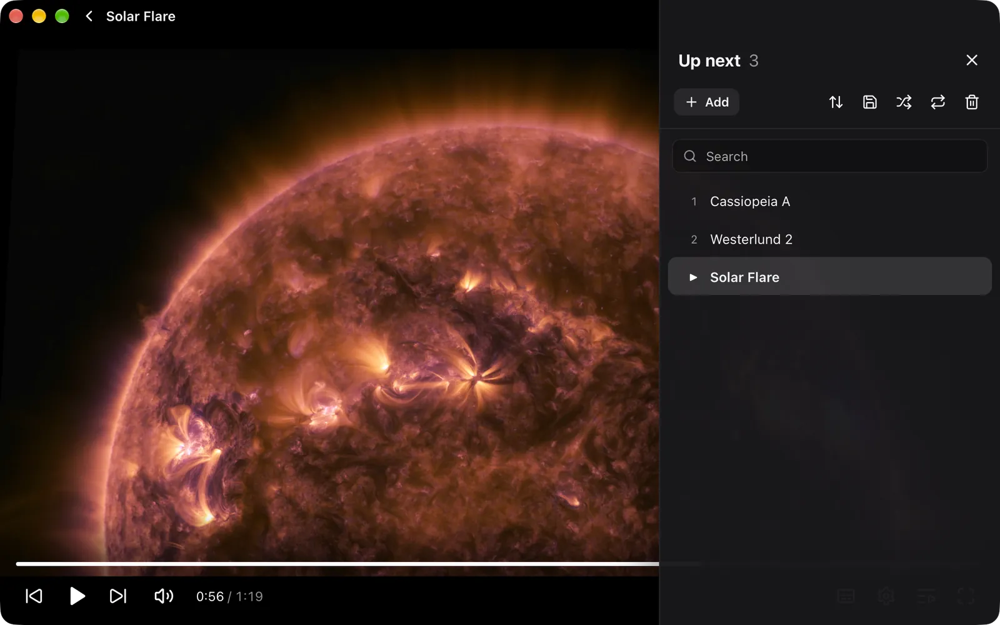</a><br><b>Up next</b>: search, sort, save as M3U, PLS or XSPF</td>
  </tr>
  <tr>
    <td><a href="docs/screenshots/jump.webp">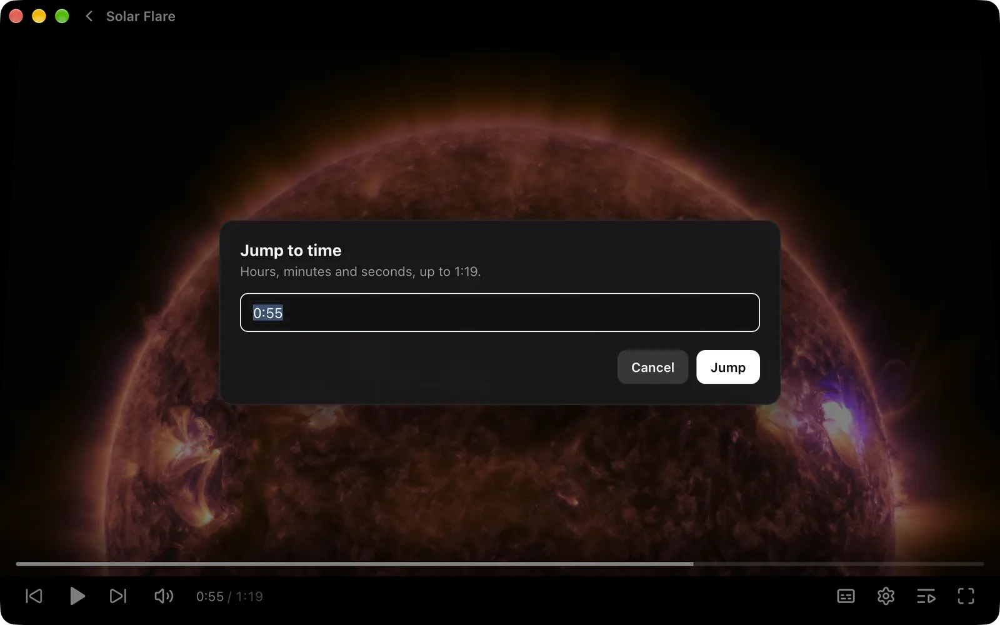</a><br><b>Jump to time</b> (⌘T)</td>
    <td><a href="docs/screenshots/disc.webp">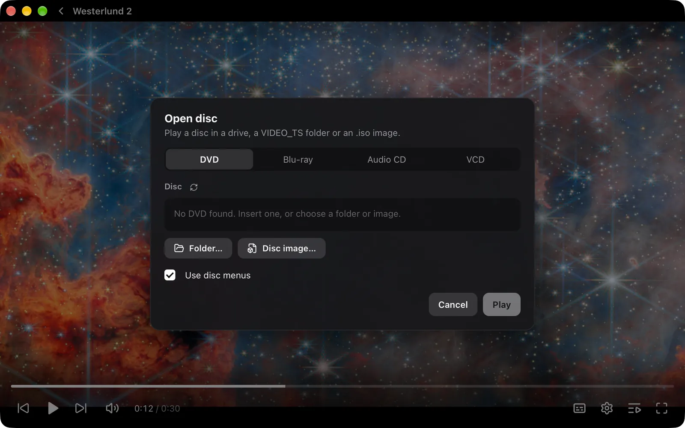</a><br><b>Open disc</b>: DVD, Blu-ray, audio CD, VCD, ISO</td>
  </tr>
  <tr>
    <td><a href="docs/screenshots/settings-general.webp">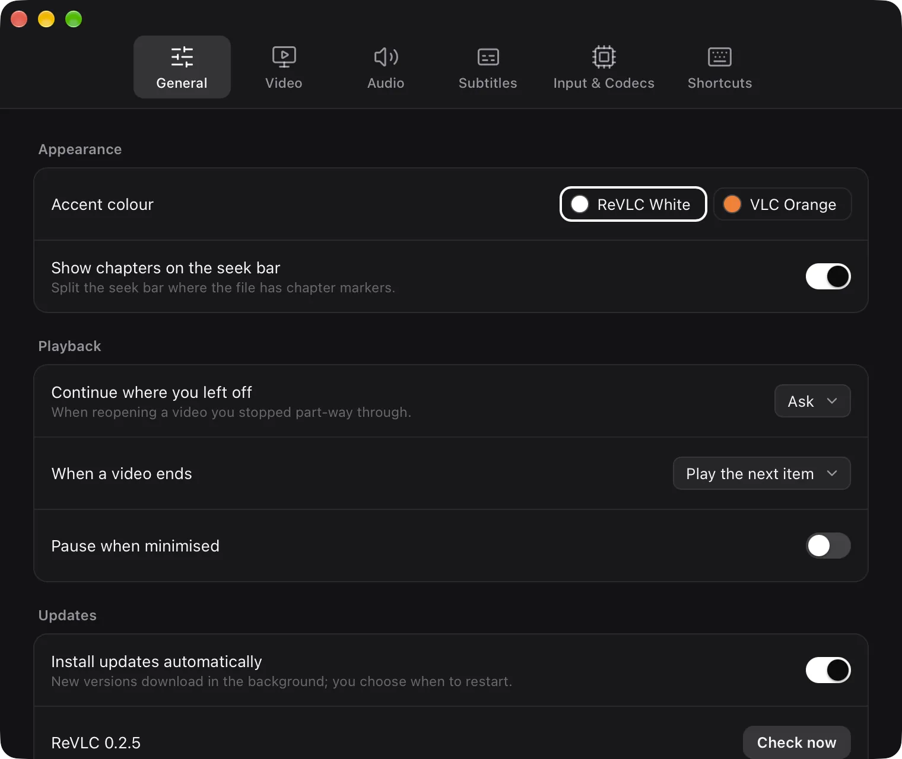</a><br><b>Settings</b>: General</td>
    <td><a href="docs/screenshots/settings-subtitles.webp">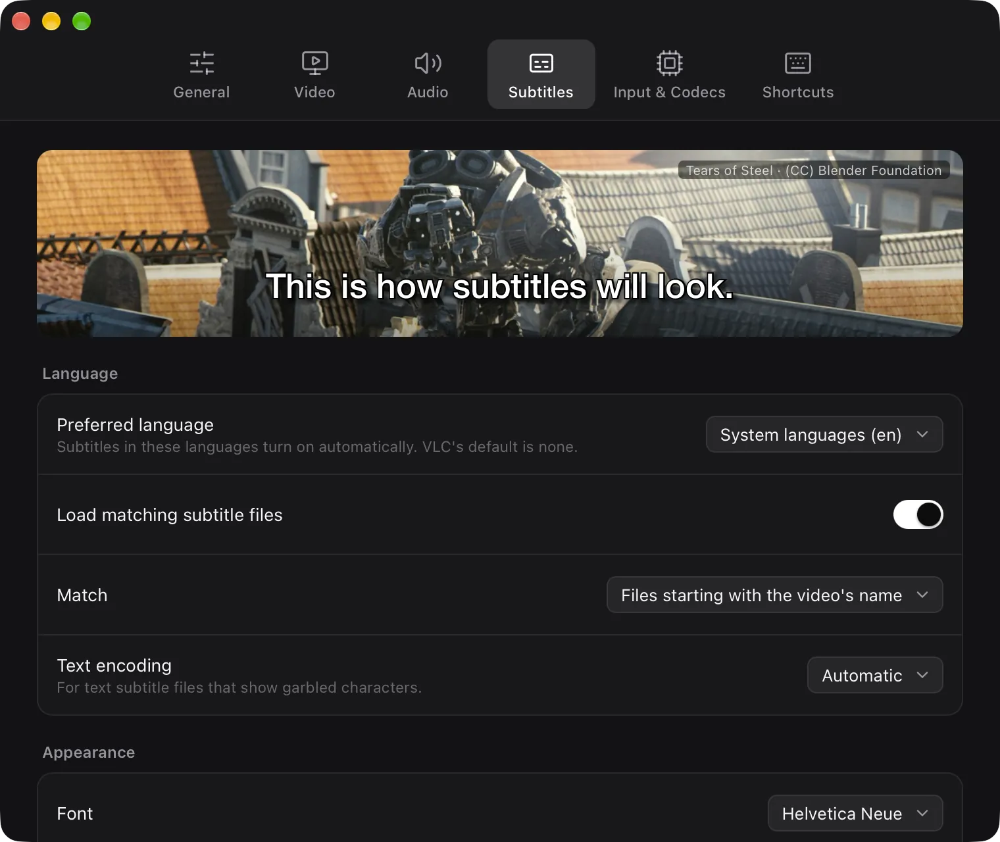</a><br><b>Settings</b>: subtitle styling with a live preview</td>
  </tr>
  <tr>
    <td><a href="docs/screenshots/settings-shortcuts.webp">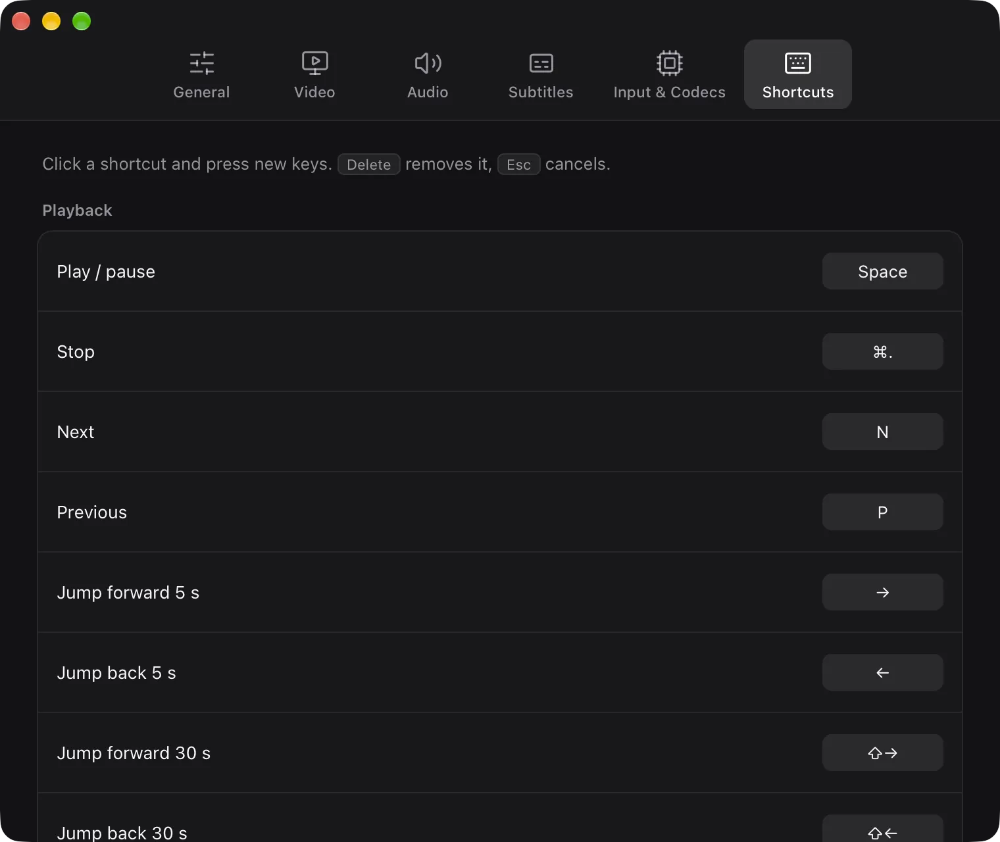</a><br><b>Settings</b>: editable, VLC-style shortcuts</td>
    <td></td>
  </tr>
</table>

</details>

## Stack

- **Engine:** libVLC 3 (the same engine as VLC), loaded at runtime
- **Core:** Rust (player state, playlist, events)
- **UI:** Tauri 2 + Svelte 5, rendered by the system web view
- **Video:** libVLC draws into a native view placed under a transparent web
  view, so the HTML controls sit on top of hardware-decoded video

See [docs/plan.md](docs/plan.md) for the reasoning and milestones.

## Install (macOS, Apple Silicon)

Download the `.dmg` from [Releases](../../releases) and drag ReVLC to
Applications. Builds aren't notarised yet, so the first time, right-click
ReVLC and choose **Open**, or run `xattr -cr /Applications/ReVLC.app`.
After that, ReVLC updates itself (Settings → General → Updates).

## Install (Windows 10 and 11, 64-bit)

Download `ReVLC-<version>-alpha-x64-setup.exe` from [Releases](../../releases)
and run it; it installs for the current user, no admin rights needed. The
installer isn't code-signed yet, so if SmartScreen warns about it, choose
**More info** → **Run anyway**.

## Building

Requirements: Rust, Node 20+. On Windows, run the scripts from Git Bash.

```sh
npm install
npm run prepare:vlc   # macOS: copies libVLC from /Applications/VLC.app or downloads VLC 3; Windows: downloads VLC 3
npm run tauri dev     # run in development
npm run build:app     # macOS: ReVLC.app and a .dmg; Windows: an NSIS installer (both in src-tauri/target/release/bundle)
```

`prepare:vlc` puts libVLC (libraries, plugins and Lua scripts, about 90 MB)
in `src-tauri/vlc`, which is bundled into the app. Without it, development
builds fall back to an installed VLC.app. Set `REVLC_VLC_DIR` to use libVLC
from somewhere else (a directory with `lib/`, `plugins/` and `share/`; on
Windows, VLC's own layout with the DLLs next to `plugins/` and `lua/`).

### Releasing

Releases are built on GitHub Actions, for free on this public repo:

1. Bump the version in `package.json`, `src-tauri/tauri.conf.json` and
   `src-tauri/Cargo.toml`. If dependencies changed, run
   `scripts/third-party-licenses.sh` (needs `cargo install cargo-about --locked --features cli`)
   to update the notices in `licenses/`. Commit and push.
2. Run the **Release** workflow (Actions → Release → Run workflow, or
   `gh workflow run release.yml -f notes="What changed"`). It makes a draft
   pre-release, builds macOS and Windows, attaches their files, and merges
   both into the update manifest. It won't rebuild a published release.
3. Download the run's `latest-json` artifact into `site/`
   (`gh run download <run id> -n latest-json -D site`) and commit it.
4. Publish the release, then deploy the site; installed copies see the update:

```sh
cd site && vercel deploy --prod
```

Updates are signed with the key in the `TAURI_SIGNING_PRIVATE_KEY` secret
(a copy of `~/.tauri/revlc-updater.key`); installed copies only accept
updates signed with it. `npm run build:app` and `scripts/release-files.sh`
still build and collect a release locally, signed with that file.

## Privacy

ReVLC sends usage statistics with no personal information: the app version,
the kind of computer, how quickly videos start and seek, and what kind of
video played (codec, resolution, length, time watched). Never file names,
titles or links. Turn it
off in Settings → General → Privacy. Details in [docs/analytics.md](docs/analytics.md).

## Known issues

- Subtitles can overlap the control bar while it's visible (Settings → Subtitles → "Raise subtitles by" moves them up).
- HDR is tone-mapped to SDR by libVLC 3 (true HDR on XDR displays is milestone M2).
- Linux isn't supported yet.
- Windows: the installer isn't code-signed yet.

## Contributing

Pick an unchecked item in [docs/parity.md](docs/parity.md). Most "engine"
items only need UI and a thin command in `src-tauri/src/vlc.rs`.

## Credits

The screenshots show a demo folder, "Deep Sky", made from these clips (chapter markers and captions added):

- [Pan of Cassiopeia A](https://esawebb.org/videos/weic2311a/): NASA, ESA, CSA, D. Milisavljevic (Purdue University), T. Temim (Princeton University), I. De Looze (UGent), J. DePasquale (STScI), N. Bartmann (ESA/Webb), M. Zimani (ESA/Webb). [CC BY 4.0](https://creativecommons.org/licenses/by/4.0/).
- [Pan of Westerlund 2](https://esawebb.org/videos/potm2512a/): ESA/Webb, NASA & CSA, V. Almendros-Abad, M. Guarcello, K. Monsch, the EWOCS team, N. Bartmann (ESA/Webb). [CC BY 4.0](https://creativecommons.org/licenses/by/4.0/).
- [Solar flare, April 17, 2016](https://svs.gsfc.nasa.gov/12224): NASA's Goddard Space Flight Center/SDO.

The subtitle preview in Settings, which ships with the app, is a still from [Tears of Steel](https://studio.blender.org/projects/tears-of-steel/), (CC) Blender Foundation, [CC BY 3.0](https://creativecommons.org/licenses/by/3.0/).

## License

Copyright (C) 2026 Hitesh Rohira

ReVLC is free software under the GPL-3.0-or-later ([LICENSE](LICENSE)).

The app bundles libVLC 3.0.24 (LGPL-2.1-or-later) and VLC plugins (mostly
GPL-2.0-or-later) from [VideoLAN](https://www.videolan.org/). Their source
code, including the build recipes for the libraries the plugins contain
(`contrib/` in the tarball), is in
[VideoLAN's 3.0.24 download folder](https://download.videolan.org/pub/videolan/vlc/3.0.24/).

The licence texts for everything the app ships, and the notices for its Rust
and JavaScript dependencies, are in [licenses/](licenses/). Installed copies
have them too.

"VLC" is a trademark of VideoLAN. ReVLC is an independent project and is not
affiliated with or endorsed by VideoLAN.
